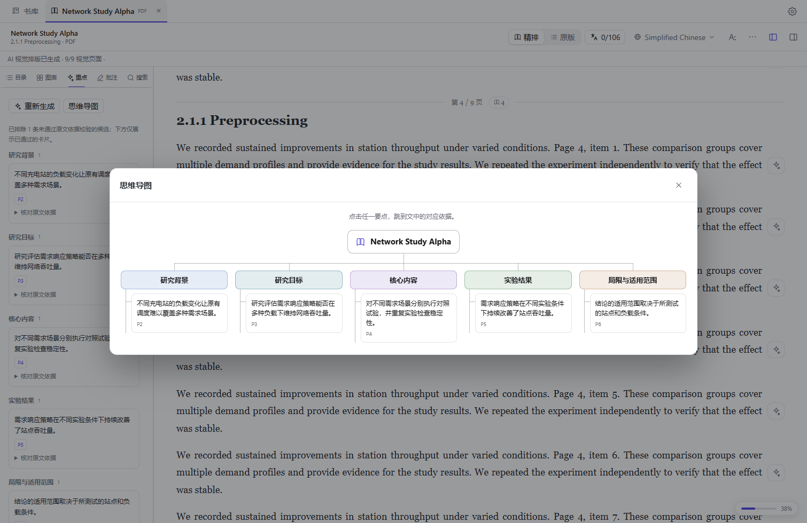

<p align="center"></p>
<h1 align="center">dsh-paperhub</h1>
<p align="center">DeepSeek Harness 的智能文献库与阅读器</p>
<p align="center">
  <a href="#文献库">文献库</a> ·
  <a href="#内置阅读器">内置阅读器</a> ·
  <a href="#快速开始">快速开始</a> ·
  <a href="#模型与部署">模型与部署</a> ·
  <a href="#开发与贡献">开发与贡献</a> ·
  <a href="./README_en.md">English</a>
</p>

在同一个书库里整理论文和电子书。打开文献后，可以逐段对照原文与译文，沿着图表和重点回到原文，也可以批注、提问和导出。

## 文献库

- **批量导入。** 一次选择多份 PDF 或 EPUB、一个文件夹或 ZIP 压缩包。把文件拖进书库文件夹，就能直接归档。
- **从网址拉取。** 在导入面板粘贴公开 PDF 直链或 arXiv 论文页地址，即可把文件加入书库。
- **Zotero 一键同步。** 在设置中连接 Zotero 后，从书库点击 **Zotero 同步**，导入条目中的 PDF 附件。

打开多篇文献后，可用顶部标签来回切换。每篇文献保留自己的阅读位置。

<!-- 待录动图。依次展示文件夹或 ZIP 导入、粘贴 arXiv 地址、点击 Zotero 同步。

-->

## 内置阅读器

### AI 精排

把双栏、跨栏图表或含公式的 PDF 整理成连续的阅读视图。左栏按层级展示目录，并提供图表缩略图。遇到复杂公式或图表，可以点回 PDF 原页核对，也可对单段公式进一步精排。

<!-- 待录动图。选一篇含双栏、跨栏图表和公式的公开论文，展示原版切到精排，再由图表回到原页。

-->

### 逐段翻译

在顶部选择目标语言，一键翻译全文。每段译文紧跟对应原文，阅读时可以直接对照。自动翻译会先处理当前视野内的段落，其余段落在后台继续。

<!-- 待录动图。打开翻译，展示计数推进和中英段落交错。

-->

### 阅读重点与思维导图

在左栏 **重点** 一键梳理论文的研究背景、目标、核心方法、实验结果和局限。生成后可以浏览分类卡片，或打开 **思维导图** 看全篇脉络。点卡片或导图节点即可跳到对应的原文依据。


<sub>界面示例使用生成的测试文献。</sub>

### AI 阅读助手

选中正文、图表或重点卡片，点提问即可把引用带进右侧 **AI 助手**。可以直接追问图里的曲线、方法的假设或某段论证，也可以在问答栏顶部切换模型。支持图片输入的模型可同时读取所选图表和图注。

<!-- 待录动图。依次从正文选区和图表侧栏发起提问，停在右栏引用与回答。

-->

### 批注与导出

选中文字即可高亮或添加批注，之后可以在左栏找到原文并修改笔记。显示译文时，**更多 → 导出全文** 会将原文与已有译文逐段写入 Markdown，例如中英对照版。也可以单独导出读书笔记和 AI 摘要。

### 个性化阅读

在设置中调整主题、纸张、字体、字号、行距、段距和阅读栏宽。可在精排视图与 PDF 原版之间切换，用 `Ctrl+F`（macOS 上为 `⌘F`） 在当前文献内查找内容。

<!-- 待录动图。切换纸张和主题，再调整字号、行距和栏宽。

-->

### 本地缓存

原文件、批注和已完成的排版、译文、重点保存在本机。重开文献时，阅读器直接复用可用的结果，省去相同内容的重复模型调用。思维导图也直接使用已生成的重点。

## 快速开始

安装 DeepSeek Harness 桌面版后，在左栏打开 **插件 → 添加插件**，填入以下安装地址。 [DeepSeek Harness 桌面版](https://github.com/deepseek-ai/deepseek-harness/tree/master/apps/desktop)

```text
github:YuigahamaHawk/dsh-paperhub#v1.0.0
```

重启 DSH，在 **插件** 页确认 dsh-paperhub 已启用，再从左侧打开 **Library（书库）**。点击 **导入** 加入第一篇 PDF 或 EPUB。打开文献后，PDF 可切换 **精排 / 原版**，点击顶部的翻译按钮开始对照阅读。

## 模型与部署

### 跟随 DSH 当前模型

翻译默认使用 DSH 当前选中的大模型。选择 **DeepSeek 账户**模型时，用量归到该账户；选择其他提供商时，以对应服务的额度或账单为准。在阅读器设置的 **AI 模型** 可单独切换翻译引擎和视觉排版模型，问答模型在 AI 助手顶部切换。

### 在本机运行 MinerU

推荐从 **MinerU 基础档（ONNX 小模型）**开始。它可以本机处理版面、OCR、图表和公式，本机解析无需调用远程大模型。Windows 下可用 uv 创建独立的 Python 3.12 环境并预下载模型。[安装 uv](https://docs.astral.sh/uv/getting-started/installation/) · [MinerU 档位与运行时](https://opendatalab.github.io/MinerU/usage/tiers/)

```powershell
uv venv --python 3.12 .venv
uv pip install --python .\.venv\Scripts\python.exe "mineru==4.1.7"
.\.venv\Scripts\mineru-kit.exe models download --tier basic --small-backend onnx --source modelscope
(Resolve-Path .\.venv\Scripts\python.exe).Path
```

在阅读器设置的 **文档解析** 中选择 **本机 MinerU** 和 **基础档**，填入最后一行输出的 Python 路径，再点击 **检测本机环境**。若想试用标准档，先按 MinerU 的指南下载该档位所需模型。

### 使用免费翻译引擎

在 **阅读器设置 → AI 模型 → 翻译引擎** 中可选择机器翻译服务。

- **MyMemory** 免密钥。选择原文语言即可使用，匿名额度为每日 5,000 字符。服务会保存提交的文本。[使用额度](https://mymemory.translated.net/doc/usagelimits.php) · [服务条款](https://mymemory.translated.net/terms-and-conditions)
- **LibreTranslate** 可自建。启动实例后填写服务地址，本机默认地址为 `http://127.0.0.1:5000`。可用语言取决于实例安装的语言包。[部署指南](https://docs.libretranslate.com/guides/installation/) · [支持语言](https://docs.libretranslate.com/guides/supported_languages/)

### 使用 WorkBuddy 积分

登录 WorkBuddy 后，在 DSH 的 **添加插件** 中填入 **dsh-connect-workbuddy**，安装并启用。然后在 DSH 的模型列表选择 WorkBuddy 模型，阅读器即可跟随该模型。积分用量以 WorkBuddy 账户记录为准。连接功能由 **dingminhua** 维护的独立插件提供。[插件源码与安装说明](https://github.com/dingminhua/dsh-connect-workbuddy)

启用远程翻译、视觉排版或问答时，阅读器会按所选服务发送任务需要的文字或图片。

## 开发与贡献

准备 Node.js 20 或更新版本。克隆仓库后，在源码目录执行安装、测试和构建。

```sh
git clone https://github.com/YuigahamaHawk/dsh-paperhub.git
cd dsh-paperhub
npm ci
npm test
npm run build
```

在 DSH 的 **添加插件** 中填入源码目录的绝对路径，将其作为本地插件安装。重启 DSH 后即可试用。

欢迎提交问题和 PR。复现文档问题时，可附 DSH 版本、解析引擎以及可公开的最小 PDF 或 EPUB 样本。[项目结构和开发约束](AGENTS.md)

## 许可证

dsh-paperhub 源码采用 [MIT 许可证](LICENSE)。随插件分发的 PDF.js、KaTeX 及相关资源保留各自的版权和许可声明。[第三方许可](assets/licenses/README.md)
