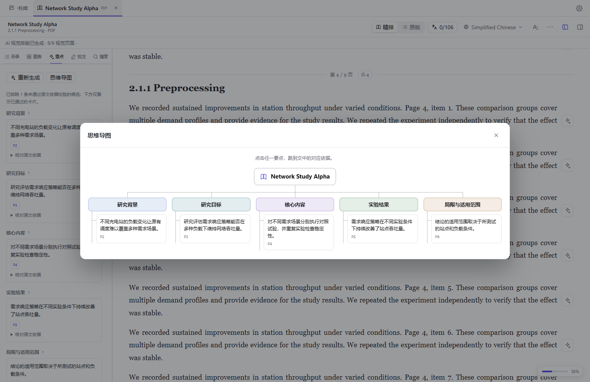

<p align="center"></p>
<h1 align="center">dsh-paperhub</h1>
<p align="center">An AI-powered literature library and reader for DeepSeek Harness</p>
<p align="center">
  <a href="#library">Library</a> ·
  <a href="#reader">Reader</a> ·
  <a href="#quick-start">Quick start</a> ·
  <a href="#models-and-setup">Models and setup</a> ·
  <a href="#development">Development</a> ·
  <a href="./README.md">简体中文</a>
</p>

Organize papers and ebooks in one library. Read each paragraph alongside its translation, follow a figure or key finding back to the source, and take notes as you read.

## Library

- **Import in batches.** Choose multiple PDFs or EPUBs, a folder, or a ZIP archive. Drop files into a library folder to file them there.
- **Import from a link.** Paste a public PDF link or an arXiv paper page into the import dialog.
- **Sync with Zotero in one click.** Connect Zotero in Settings, then choose **Zotero sync** in the library to import PDF attachments.

Keep several documents open in tabs. Each document remembers where you left off.

<!-- Record a folder or ZIP import, an arXiv import, and a Zotero sync.

-->

## Reader

### AI-assisted reflow

Turn PDFs with multiple columns, wide figures, or equations into a continuous reading view. Browse the nested table of contents and figure thumbnails, then jump back to the original PDF page whenever you need to check the layout. Inline formulas can also be refined one paragraph at a time.

<!-- Show a complex paper in the original and reflowed views, then jump from a figure to the source page.

-->

### Paragraph-by-paragraph translation

Choose a target language in the toolbar and translate the entire document in one click. Each finished translation appears beneath its source paragraph as soon as it is ready. Automatic translation starts with the paragraphs on screen and continues through the rest of the document in the background.

<!-- Show translation progress and the alternating source and translated paragraphs.

-->

### Reading highlights and mind map

Generate an overview of a paper's background, aims, methods, results, and limitations from the **Key points** tab. Browse the cards or open the **Mind map** to see the paper's structure. Select a card or a node to jump to its supporting passage.


<sub>The screenshot uses a generated test document.</sub>

### AI reading assistant

Select text, a figure, or a key point and bring it into the **AI assistant** with a single click. Ask about a curve, a methodological assumption, or a passage in context. Switch models at the top of the assistant. A model that accepts images receives the selected figure together with its caption.

<!-- Ask a question about selected text and then a figure, showing the attached context in the assistant.

-->

### Annotations and export

Highlight text or attach a note, then revisit the original passage from the sidebar. With translations visible, **More → Export full text** writes a Markdown document with source and translated paragraphs in reading order. Reading notes and AI summaries can be exported separately.

### Personalize the reading view

Adjust the theme, paper color, font, type size, spacing, and column width. Switch between the reflowed and original PDF views, or search the current document with `Ctrl+F` (`⌘F` on macOS).

<!-- Switch paper colors and adjust the type size, line spacing, and width.

-->

### Local cache

Original files, annotations, reflowed layouts, translations, and reading highlights are stored locally. Reopening a document reuses saved results and saves repeat model calls. The mind map uses the same saved highlights.

## Quick start

Install DeepSeek Harness Desktop. Open **Plugins → Add plugin** and enter the following source. [DeepSeek Harness Desktop](https://github.com/deepseek-ai/deepseek-harness/tree/master/apps/desktop)

```text
github:YuigahamaHawk/dsh-paperhub#v1.0.3
```

Restart DSH and confirm that **dsh-paperhub** is enabled on the Plugins page. Open **Library** from the sidebar, then choose **Import** to add a PDF or EPUB. For a PDF, use **Reflow / Original** to switch views. Use the translation button in the toolbar to start bilingual reading.

## Models and setup

### Use the current DSH model

Translation follows the model selected in DSH by default. Calls to a **DeepSeek Account** model are attributed to that account. Other providers apply their own quotas or billing. Choose a separate translation engine or a vision model under **AI Models** in reader settings, or switch the Q&A model in the AI assistant.

### Run MinerU locally

Start with the **Basic tier and its small ONNX models** for local layout analysis, OCR, tables, and formulas. This route runs on your machine without a remote model call. On Windows, create an isolated Python 3.12 environment with uv and download the models in advance. [Install uv](https://docs.astral.sh/uv/getting-started/installation/) · [MinerU tiers and runtimes](https://opendatalab.github.io/MinerU/usage/tiers/)

```powershell
uv venv --python 3.12 .venv
uv pip install --python .\.venv\Scripts\python.exe "mineru==4.1.7"
.\.venv\Scripts\mineru-kit.exe models download --tier basic --small-backend onnx --source modelscope
(Resolve-Path .\.venv\Scripts\python.exe).Path
```

In reader settings, open **Document parsing** and select **Local MinerU** and **Basic**. Paste the Python path printed by the last command and run the local environment check. For the Standard tier, download the models listed for that tier in the MinerU guide.

### Use a free translation engine

Open **AI Models → Translation engine** in reader settings to choose a machine translation service.

- **MyMemory** works without an API key. Choose the source language and translate within the anonymous allowance of 5,000 characters per day. MyMemory stores submitted text. [Usage limits](https://mymemory.translated.net/doc/usagelimits.php) · [Terms](https://mymemory.translated.net/terms-and-conditions)
- **LibreTranslate** can be self-hosted. Start your instance and enter its server URL. The local default is `http://127.0.0.1:5000`. The languages available depend on the language packages installed on that instance. [Setup](https://docs.libretranslate.com/guides/installation/) · [Supported languages](https://docs.libretranslate.com/guides/supported_languages/)

### Use WorkBuddy credits

Sign in to WorkBuddy, then install and enable **dsh-connect-workbuddy** from **Add plugin** in DSH. Choose a WorkBuddy model in DSH and the reader can use it through the host. Check credit usage in your WorkBuddy account. The connection is provided by **dingminhua**'s independent plugin. [Source and installation](https://github.com/dingminhua/dsh-connect-workbuddy)

Remote translation, vision layout, and Q&A send the text or images needed for the request to the selected provider.

## Development

Install Node.js 20 or later, clone the repository, and run the checks and build from the checkout.

```sh
git clone https://github.com/YuigahamaHawk/dsh-paperhub.git
cd dsh-paperhub
npm ci
npm test
npm run build
```

In DSH, open **Add plugin** and enter the absolute path to the checkout to install it locally. Restart DSH after building to try the updated plugin.

Issues and pull requests are welcome. For document-specific bugs, include the DSH version, the parsing engine, and a minimal PDF or EPUB you can share publicly. [Architecture and development notes](AGENTS.md)

## License

dsh-paperhub is released under the [MIT License](LICENSE). Bundled components such as PDF.js, KaTeX, and fonts retain their own copyright and license notices. [Third-party notices](assets/licenses/README.md)
